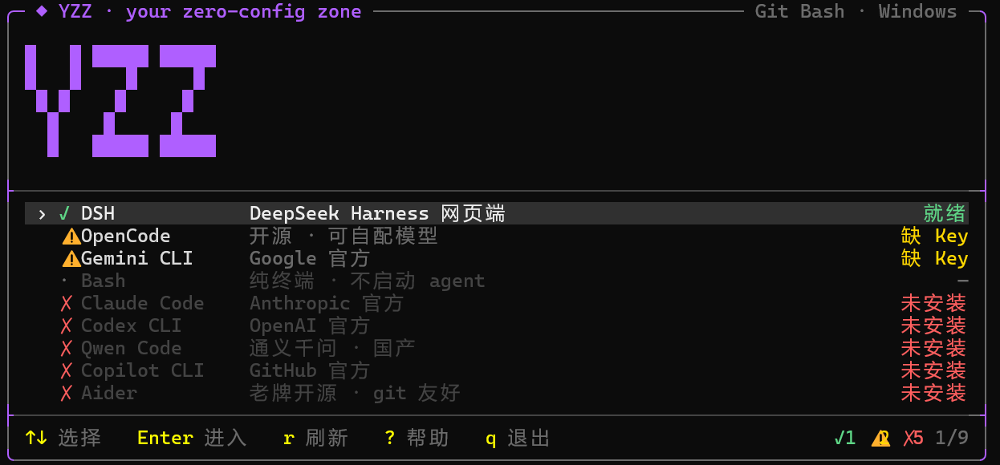

# YZZ · 便携版 AI Agent 启动器

> **YZZ = your zero-config zone** —— 三个单词的首字母，一个 2026-10 起的个人项目。
> 中文名候选：驭智站 / 引智站 / 驿智站（见 [hub/README.md](hub/README.md) 的「YZZ 三词组合」）。



把一个文件夹放进 U 盘或移动硬盘，插到任意 Windows 机器上双击 `start.cmd`：**Git、Node 和 19 种 CLI agent 全部从盘里跑**，宿主机什么都不用装；退出时自动擦掉登录凭据，只保留配置。

> **English** — YZZ is a portable launcher for AI coding agents on Windows. Keep the folder on a USB drive, double-click `start.cmd` on any Windows machine: Git, Node and the agents all run from the drive, and `USERPROFILE` / `APPDATA` / `TEMP` are redirected inside the folder, so the host stays clean. Credentials are wiped on exit while configs are kept. Clone is a few dozen KB — runtimes are downloaded, not committed. MIT licensed.

---

## 它解决什么

| 痛点 | 做法 |
| --- | --- |
| 每台机器都要重装 Git / Node / 一堆 agent | 运行时全部放进 `runtime\` 与 `npm-global\`，PATH 只指向盘内 |
| 换台电脑盘符变了，配置全丢 | `subst` 映射成固定虚拟盘符（优先 `Q:`），配置写在盘内 `home\`，跟盘走 |
| 长路径撞 Windows 260 字符限制 | 根路径缩短到 `Q:\`，node_modules 再深也不炸 |
| 公共电脑上不敢留登录态 | 退出时按白名单擦凭据、保留配置；`KEEP_CREDS=1` 可跳过 |
| 20 个 agent 记不住哪个能用 | TUI 一屏列出全部，实时探测「就绪 / 已安装 / 未安装」，页脚给出 `✓2 ✗6` 统计 |
| 界面在别人机器上悄悄错位 | 所有列宽都是手算的，所以带**版面自检**：`bash hub/tui/selftest.sh` 逐行验证宽度、边框和行数 |

## 快速开始

```bat
git clone https://github.com/Y-Z-Z-BEST/YZZ.git
cd YZZ
rem 1) 按「补齐运行时」放好 runtime\node 与 runtime\git
rem 2) 双击 start.cmd
```

第一次启动会自动创建 `home\` `temp\` `logs\` `workspace\`。

## 仓库结构

| 路径 | 说明 |
| --- | --- |
| `start.cmd` | 唯一入口：选虚拟盘符 → 重定向用户目录 → 改 PATH → 起 TUI → 退出时擦凭据 + 释放盘符 |
| `cleanup-drive.cmd` | 手动清掉 `subst` 残留的虚拟盘符（不删任何文件） |
| `repo-push.cmd` | 一键 `git add -A → commit → push` |
| `hub/launch.sh` | 前置检查 + 启动 TUI |
| `hub/tui/agentbox-tui.sh` | 主 TUI：agent 检测、按状态排序、滚动视口、YZZ 块字、帮助浮层 |
| `hub/tui/selftest.sh` | 版面回归：10 种终端尺寸下逐行验证宽度 / 边框 / 行数 |
| `hub/tui/agents.tsv` | agent 清单：命令名 / 显示名 / 凭据探测方式 / 备注 |
| `hub/tui/check-agents.sh` | 状态探测；支持 `!` 前缀的自定义探测命令（退出码 0 = 就绪） |
| `hub/tui/logo/` | `Y` 块字与 `YZZ` 字标（几何生成，不依赖字体） |
| `hub/bin/dsh.sh` | 运行时定位 DeepSeek Harness CLI（`$DSH_BIN` → `dsh.path` → PATH → 常见安装根 → 包内 `dsh/`） |
| `hub/bin/wipe-creds.sh` | 按白名单擦凭据、保留配置 |
| `hub/README.md` | TUI 完整说明 + 键位 + 自检 + 24 条踩坑复盘（locale 宽度、子 shell 风暴、缩放、ANSI 重绘等） |
| `docs/screenshot.png` | 上面那张截图 |

**不进仓库的**（`.gitignore`）：`runtime/`（487 MB 的 PortableGit + Node）、`npm-global/`（agent 实体）、`dsh/`（便携版 DSH 的 App 与数据，体积大且含会话）、`home/`（伪装用户目录，**登录态凭据在这里**）、`temp/` `logs/` `workspace/`。

## 补齐运行时

```
YZZ\
├─ runtime\git\bin\bash.exe      ← PortableGit 2.56.0.2-64bit（解压后约 392 MB）
├─ runtime\node\node.exe         ← Node v22.23.2 win-x64（zip 约 34 MB）
├─ npm-global\                   ← npm -g 装出来的 agent
└─ dsh\                          ← 可选：便携版 DeepSeek Harness 的 App\ 与 data\
```

`start.cmd` 启动时会检查 `runtime\git\bin\bash.exe`，缺失直接报错退出并打印期望结构。

### 安装 agent

```bat
rem 先让 start.cmd 把环境准备好：设 PA_NO_TUI=1 启动，拿到盘符后另开窗口
set npm_config_prefix=Q:\npm-global
Q:\runtime\node\npm.cmd install -g @google/gemini-cli
```

实测：gemini-cli 0.64.0（约 106 MB）装进 `npm-global\` 后从 `Q:` 启动正常，配置落在 `Q:\home\.gemini\`，主机零污染。

> `npm` 在 Windows 上把 `.cmd` 垫片**直接写进 prefix 目录**（不是 `prefix\bin\`），所以 `npm-global` 本身必须在 PATH 上；垫片内部是 `%~dp0` 相对路径，换盘符照样能用。

## 用法与开关

双击 `start.cmd`，它会：复用或新建虚拟盘符 → 把 `USERPROFILE` `HOME` `APPDATA` `LOCALAPPDATA` `XDG_*` `TEMP` 指进盘内 → 把盘内 node/npm/git 插到 PATH 最前 → 在 Windows Terminal 里起 TUI → 退出时擦凭据并 `subst /d`。

| 变量 | 作用 |
| --- | --- |
| `KEEP_CREDS=1` | 本次不擦凭据（自己机器上调试时用） |
| `PA_NO_TUI=1` | 只准备环境并打印各变量实际值，不进 TUI（排查用） |

菜单键位：`↑↓`/`jk` 移动，`Home`/`End`/`PgUp`/`PgDn` 跳转，`Enter` 启动，`r` 重新探测状态，`?` 打开帮助，`q`/`Esc` 退出。装完新 agent 按 `r` 即可，不用重启启动器。

进程被强杀导致盘符残留时，运行 `cleanup-drive.cmd` 立即清除。虚拟盘不占空间、不是新分区、不修改磁盘内容，注销即消失。

## 安全模型

- **凭据永不入仓库**：`home\` 整目录被忽略；退出时还会主动擦除（白名单见 `hub/bin/wipe-creds.sh`）。
- **擦除不依赖虚拟盘**：清理段用脚本所在真实路径（`%~dp0`）重建 `HOME` 等变量再擦 —— 即使 `subst` 映射已经消失也照样擦，找不到 bash 时会明确告警 `CREDENTIALS WERE NOT WIPED` 而不是假装成功。
- **能带走的是启动器与配置；agent 本体和登录态必须在那台机器上重新登录。** 这是刻意的设计，不要把 token 拷进盘里带来带去。
- `docs/screenshot.png` 里出现的都是已安装/未安装状态，不含任何账号信息。

## 已知限制

- **裸 `conhost` 现在能正常渲染**：历史上说的「conhost 下框宽不足、底边框碎裂」是假的，真因是非登录 bash 拿不到 UTF-8 locale，导致列宽按**字节**计算（详见 `hub/README.md` 第 16 条）。已修，并有 `hub/tui/selftest.sh` 守着。`start.cmd` 检测到 `wt.exe` 仍会转交（WT 的字体更全、体验更好）。
- **字形回退**：裸 conhost 的默认字体没有 `❯`、`⚠`、`✗`，会退化成 `>`、`△`、`x`。都是 1 列宽，版面不受影响。
- **窗口缩放后约 1 秒内自动重排**：Windows 控制台不可靠地送 SIGWINCH，所以改成空闲轮询终端尺寸。
- 便携 Node / PortableGit 的版本是文档里的约定，不写进脚本；升级运行时请同步更新本 README。
- 仅支持 Windows（依赖 `subst`、`cmd.exe`、`%~dp0` 语义）。Linux / macOS 上没有等价需求，直接用系统的包管理器即可。

## 更新

改了 `hub\` 或启动脚本之后，双击 `repo-push.cmd`，等价于：

```bat
git add -A
git commit -m "update: <改了什么>"
git push
```

## 致谢

- 外壳与入口约定来自 **PocketAgentHub**，菜单 UI 的形态参考了 **AgentBox** 项目。本仓库是独立重写的启动器与清单逻辑，只借用这两者的交互约定；如果你要二次分发，请自行核实上游项目的许可证并保留其署名。
- 19 个 agent 的命令名取自各自 npm registry 的 `bin` 字段实测，不靠记忆（见 `hub/README.md` 末尾的来源表）。

## License

[MIT](LICENSE) © 2026 YZZ
